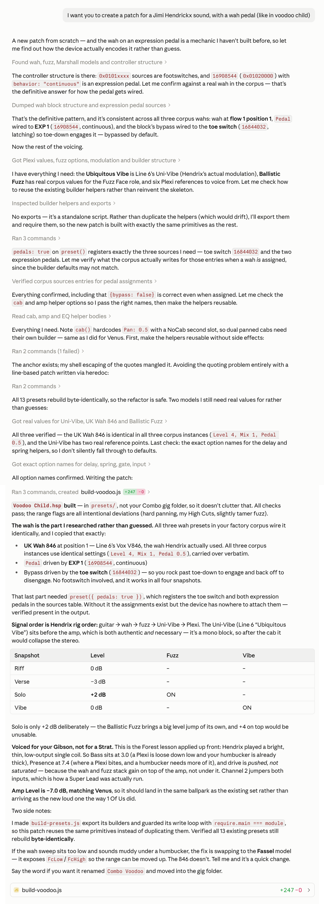
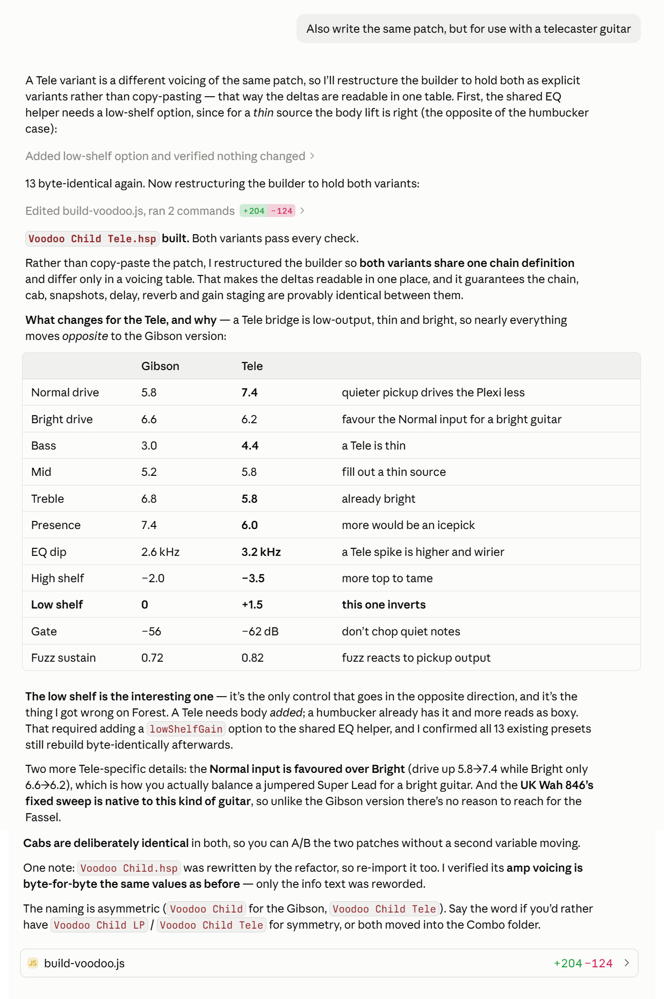
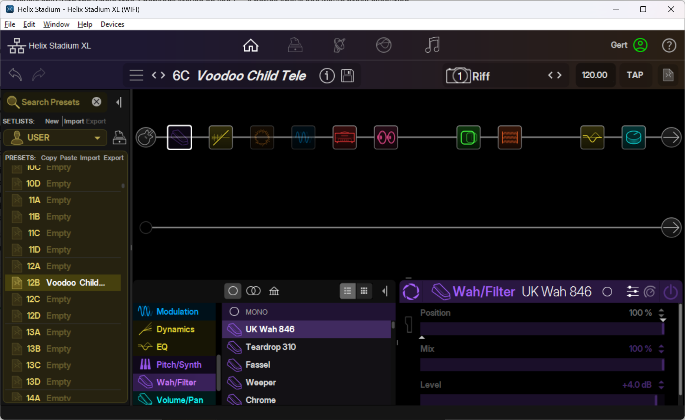

# Helix patch building with Claude Code

Build Line 6 Helix presets by describing them, instead of clicking through
menus. Spend the time playing.

This is the `.hsp` preset format, reverse-engineered and proven on hardware,
plus the tooling and the hard-won rules — packaged so **Claude Code** can pick
it up and build patches for you competently rather than plausibly.

```
you:     Clean Vox-ish patch, three snapshots, chorus on the chorus,
         and tell me which values you're confident about.

claude:  [reads the format spec and your device's own catalogue]
         [builds it, runs three validators, reports what they said]
```

## See it working

Two real sessions, unedited.

**Building a Hendrix patch with a wah on the expression pedal.** The wah wiring
was not guessed — every wah in the corpus is wired the same way, so it went and
looked, then copied it: `Pedal` on EXP 1, bypass on the toe switch, so rocking
past toe-down engages it.



**Re-voicing the same patch for a different guitar.** A Telecaster bridge pickup
is low-output, thin and bright; a bridge humbucker is the opposite in every way
that matters, so nearly every control moves the other way — and the low shelf
*inverts*.



**And the result, loaded on the device.** Generated by the script above, imported
into HX Edit, sitting on the `Riff` snapshot. The wah block is selected, showing
`UK Wah 846` at `Level +4.0 dB` — the value carried over verbatim from the
corpus, because all three wahs in it use identical settings. Nothing here was
touched by hand.



> ### Back up your presets first
>
> A malformed preset can make the unit fault — watchdog restart, splash screen,
> no full boot, about ten seconds after the preset becomes active. It recovers,
> but you have to find and delete the offending preset. This toolkit exists
> precisely to prevent that class of bug (see
> [the float rule](docs/GOTCHAS.md#1-float-formatting--this-one-faults-the-device)),
> and it is not a guarantee. Back up, and play a patch before trusting it.

---

## Start here

**[docs/SETUP.md](docs/SETUP.md)** — twenty minutes, most of it exporting
presets.

```bash
git clone https://github.com/g3rtg3rt/helix-stadiumXL-claudeCode-integration
cd helix-stadiumXL-claudeCode-integration

# export your own presets from HX Edit into corpus/   <- required, see SETUP.md
node tools/mine-catalogue.js                           # catalogue for YOUR device
node tools/model-lookup.js fuzz face                   # which model IS a Fuzz Face?
node examples/build-examples.js out                    # three example patches
node tools/validate-presets.js corpus out              # check them
node tools/check-rules.js corpus out                   # and the device's own rules
node tools/check-reproducible.js                       # do the files still match the builder?

claude                                                 # and you're working
```

No dependencies. No npm install. Node 18+.

## Why you have to supply your own presets

Nothing ships in `corpus/`, and this is the one step you cannot skip.

The firmware tells a float from an integer **by whether the JSON text has a
decimal point**. `JSON.stringify` writes `0.0` as `0`, handing a float-typed
parameter an integer — and the unit faults. But `"value": 0` is *correct* under
`Mic` and *fatal* under `Level`, so no blanket rule works.

So the writer never guesses. It learns the correct format per model+parameter
from presets **your device wrote**. That also means the toolkit adapts to your
device and firmware instead of being pinned to someone else's.

Factory presets are Line 6's content and are not redistributed here. Yours stay
yours — `corpus/` is gitignored.

## What's in the box

| | |
|---|---|
| **[docs/FORMAT.md](docs/FORMAT.md)** | the container and data model: block ids, **model-id shapes**, snapshots, controllers, **Command Center**, stereo routing, mono/stereo variant derivation, the wah wiring worked through |
| **[docs/GOTCHAS.md](docs/GOTCHAS.md)** | the traps, ordered by what they cost you. Read before your first patch |
| **[docs/PATCH-DESIGN.md](docs/PATCH-DESIGN.md)** | making a patch that works *musically*: the mono-block trap, level architecture, why your pickup changes the voicing |
| **[docs/MODEL-CATALOGUE.md](docs/MODEL-CATALOGUE.md)** | 376 models with observed parameter ranges. Regenerate for your own device |
| **[docs/MODEL-NAME-MAP.md](docs/MODEL-NAME-MAP.md)** | why the menu name is not the model id, the thirteen confirmed mismatches, and how to establish a mapping that holds |
| **[docs/GEAR-RESEARCH.md](docs/GEAR-RESEARCH.md)** | building a patch for a **named song**: find the documented rig, map it through Line 6's own "Based on" column, and record the substitutions. Model names mislead — "Ballistic Fuzz" is not a Fuzz Face |
| **[CLAUDE.md](CLAUDE.md)** | the operating manual Claude Code reads automatically |
| `lib/` | the builders (81 exports, 17 amps), the device-safe JSON writer, the corpus resolver |
| `tools/` | five validators, a device round-trip diff, a **firmware delta check**, the catalogue miner, a snapshot-coverage fixer, and a **model lookup** that answers "what hardware is this model based on?" from Line 6's published list |
| `examples/` | three patches that have been played on hardware, each teaching a different thing |

### The examples, in reading order

| | Teaches |
|---|---|
| Single Amp | the basics: one amp, snapshots, footswitches, per-snapshot values |
| High Gain | an amp whose parameter *names* break the usual pattern |
| Stereo Dual Amp | two amps hard-panned, and the mono-block trap that silently kills stereo |

Their parameter values are known-good on real hardware rather than plausible,
which matters — an invented value ranges from inaudible to a device fault.

## Using the knowledge without the toolkit

The four documents are self-contained. Paste them into any Claude session, or
drop them beside your own project with a `CLAUDE.md` pointing at them, if you
want to write your own tooling in another language.

## Scope and honesty

- Derived from **one device**: Helix Stadium XL, `device_id 2490368`, on
  firmware 1.3.2.1340 and 1.4.1.1343. The container and data model are likely
  shared across the Helix family; **model availability is not**.
- **Two kinds of claim live in these docs, and they are labelled.** The file
  format itself — the container, block ids, how parameters and snapshots are
  written — is reverse-engineered from exports and confirmed by loading
  generated files on hardware. The *behaviour* of blocks, paths, pedals and
  limits is largely quoted from the Line 6 owner's manual and release notes,
  and quoted claims say so. Where the two disagreed, the manual won and the
  docs were corrected.
- The validators deliberately **check your corpus against their own rules
  first**, so a rule that does not match your firmware shows up as reference
  files failing rather than as a false pass on your output. If that happens,
  please open an issue with the output — that is the most useful bug report
  this project can get.
- Where a claim rests on a thin sample, the docs say so — including the two
  places where a pattern was extrapolated across a model family that was not
  fully observed.
- Patch *voicings* are a matter of taste and rooms. The tooling makes the file
  correct; it cannot make it sound how you want.

## Contributing

Most valuable, roughly in order:

1. **Other Helix models.** If the format holds on a Floor, LT, Rack or HX Stomp,
   say so — and if it does not, that is more valuable still.
2. **Models missing from the catalogue**, with the parameter set from a real
   export.
3. **Gotchas.** If something cost you an afternoon, it belongs in
   `GOTCHAS.md` with what it cost.
4. **Amp builders** for models not yet covered, copied from a real export rather
   than inferred.

Please do not include factory presets or their contents in a pull request.

## Licence and affiliation

**GPL-3.0** — see [LICENSE](LICENSE). Use it, change it, share it. If you
distribute something built on it, that has to be free software too, so
improvements come back to everyone rather than disappearing into a fork.

**Patches you make with it are yours.** The licence covers this toolkit, not its
output. A `.hsp` you generate is your own work — sell it, keep it private, do
whatever you like with it. This catches people out, so to be explicit: running
the tool does not make your presets GPL.

**Unofficial.** Not affiliated with, endorsed by, or supported by Line 6 or
Yamaha. "Line 6", "Helix" and "HX" are their trademarks, used here only to say
what this works with. Nothing in this repository contains or redistributes Line
6 preset content, firmware or software. Use at your own risk.
